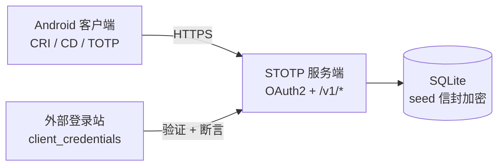
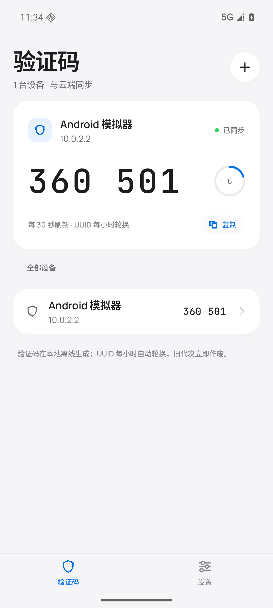
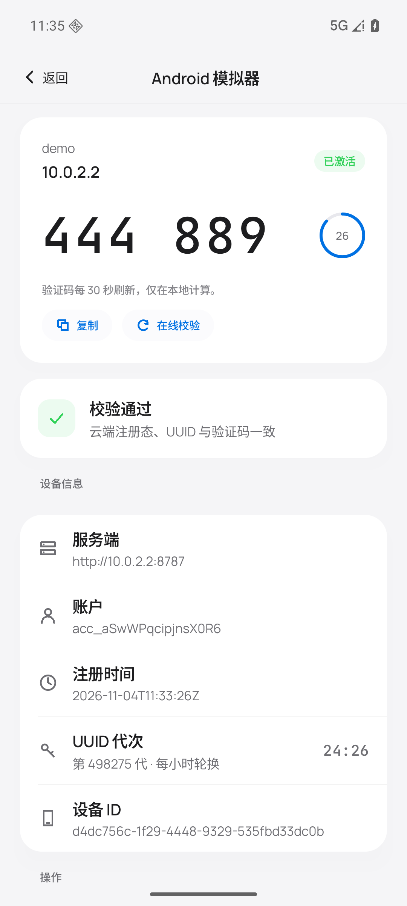
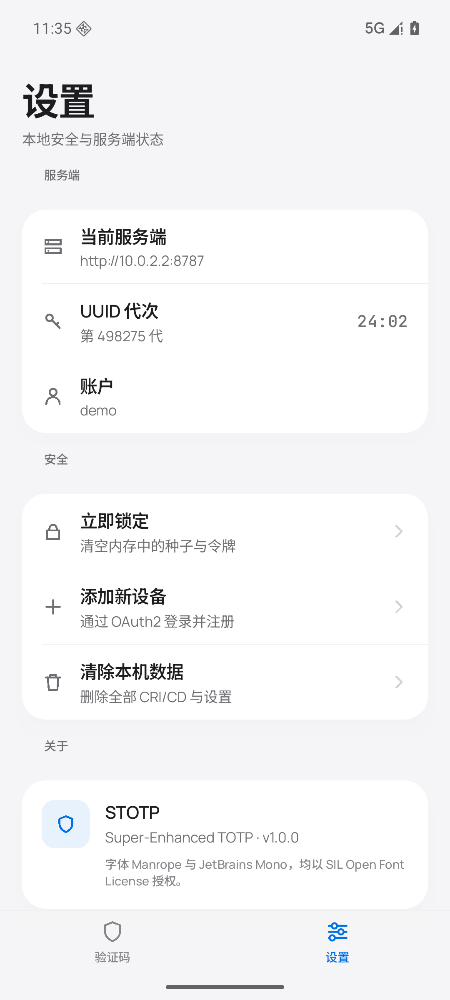
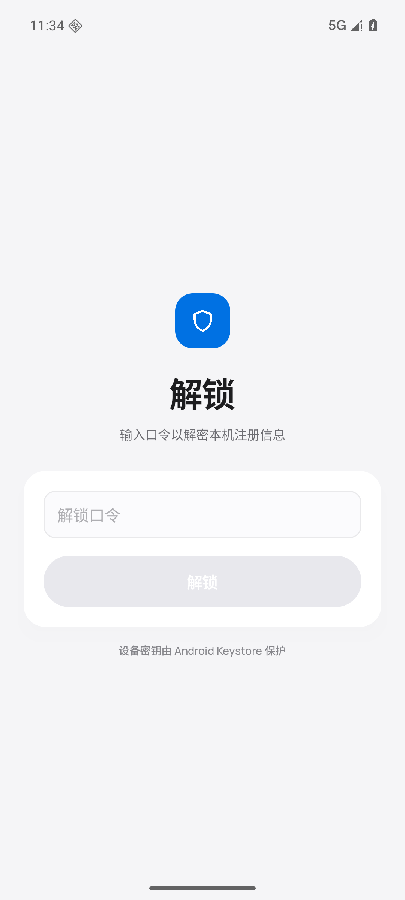

# STOTP

**Super-Enhanced TOTP** —— 在标准 TOTP 之上，叠加「在线注册态校验」与「小时级 UUID 轮换」的二次验证方案。

> 普通 TOTP 的问题：种子一旦被复制，验证码可以无限生成。STOTP 把每个验证码绑定到
> **当前设备实例**（加密的客户端注册信息 CRI）与 **当前小时**（确定性 UUID），
> 副本在下一个整点即失效；注册态与云端不符时，客户端描述文件立即作废。

## 特性

| | |
| --- | --- |
| **标准 TOTP** | RFC 6238，6 位、30 秒、±1 步容差，离线可用 |
| **CRI 注册信息** | 完全加密文件，口令 + 设备密钥双重保护，保存种子与 UUID 绑定 |
| **CD 描述文件** | AES-256-REG 封装的 TOTP Token，AAD 绑定 `client_id` 与小时代次 |
| **UUID 小时轮换** | `HMAC(seed, client_id ‖ epoch)` 确定性派生，旧代次立即作废并释放 |
| **服务端强制轮换** | `min_epoch` 公告，已信任客户端同步后自动跳代 |
| **抗枚举** | 验证接口恒 200 + 定长密文 + 恒定耗时 + 限速锁定 + 重放缓存 |
| **OAuth2 用户中心** | 授权码 + PKCE、动态客户端注册、刷新令牌、OIDC 发现文档 |

## 架构



详见 [`docs/architecture.md`](docs/architecture.md)。

## 目录

```
STOTP/
├── docs/
│   ├── architecture.md      # 系统架构与关键流程
│   ├── crypto-protocol.md   # KDF、AES-256-REG、UUID 算法、响应封装
│   ├── api.md               # HTTP API 参考
│   └── security.md          # 威胁模型与抗枚举设计
├── server/                  # Python 3.11+ 服务端 + unittest 自检
└── android/                 # Kotlin / Jetpack Compose 客户端
```

## 快速开始

### 服务端

```powershell
cd server
python -m pip install -r requirements.txt
python -m stotp --dev-login --create-account demo:demo1234 --db .\data\stotp.db
# 首次启动自动生成 data/keys/{master,session,token}.key
# 打开 http://127.0.0.1:8787/healthz
```

### Android 客户端

```powershell
cd android
.\gradlew.bat :app:assembleDebug
# APK: app\build\outputs\apk\debug\app-debug.apk
```

Android 端默认连接 `http://10.0.2.2:8787`（模拟器映射到宿主机），也可在设置页修改服务端地址。

## 文档

- [系统架构](docs/architecture.md)
- [密码学协议](docs/crypto-protocol.md)
- [HTTP API](docs/api.md)
- [安全设计](docs/security.md)

## 设计

客户端视觉遵循 **Apple Liquid Glass** 规范（`#f5f5f7` 冷灰底、白色统一面板 + 发丝分隔线、
玻璃只用于导航/浮层、单一强调蓝），并以 UI/UX Pro Max 的 Compose 无障碍与动效准则补足
触控目标与对比度。设计令牌集中在
`android/app/src/main/java/com/endercraft/stotp/ui/theme/`。

| 验证码 | 设备详情 |
| --- | --- |
|  |  |

| 设置 | 解锁 |
| --- | --- |
|  |  |

## 安全

- 验证接口不通过状态码、响应长度或明文布尔值泄露结果。
- 服务端 seed 以 AES-256-GCM 信封加密落库，主密钥不落盘。
- 完整威胁模型见 [`docs/security.md`](docs/security.md)。

## 状态

| 交付物 | 状态 |
| --- | --- |
| 技术文档 | ✅ 已交付 |
| STOTP 服务端 | ✅ 已交付（14 个 unittest） |
| Android 客户端 | ✅ 已交付（模拟器全流程验证） |
| OAuth2 登录站 | 不在本仓库（部署在运营方本地，通过 OAuth2 回调接入） |
