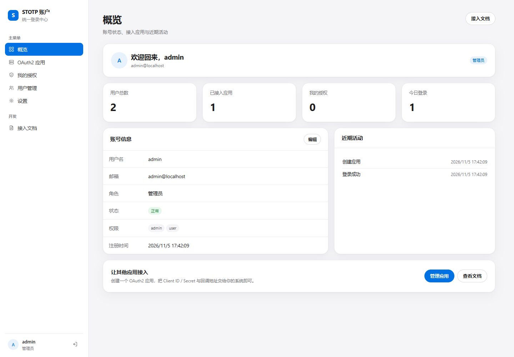
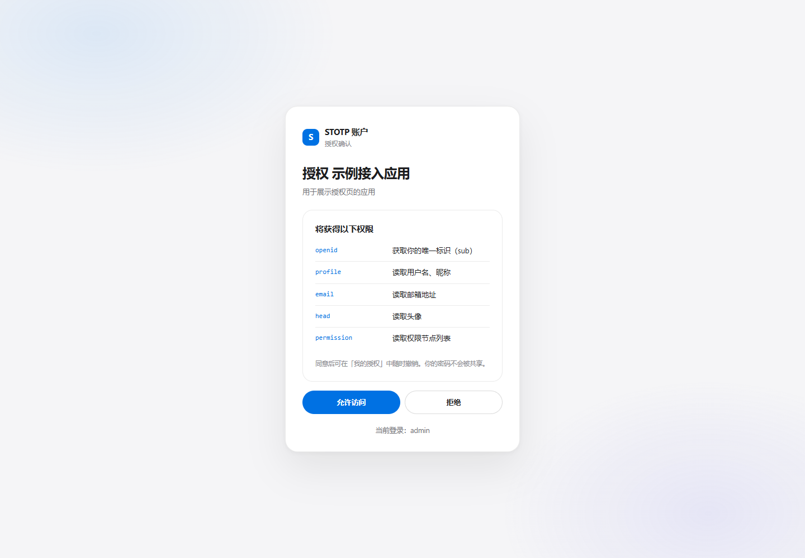
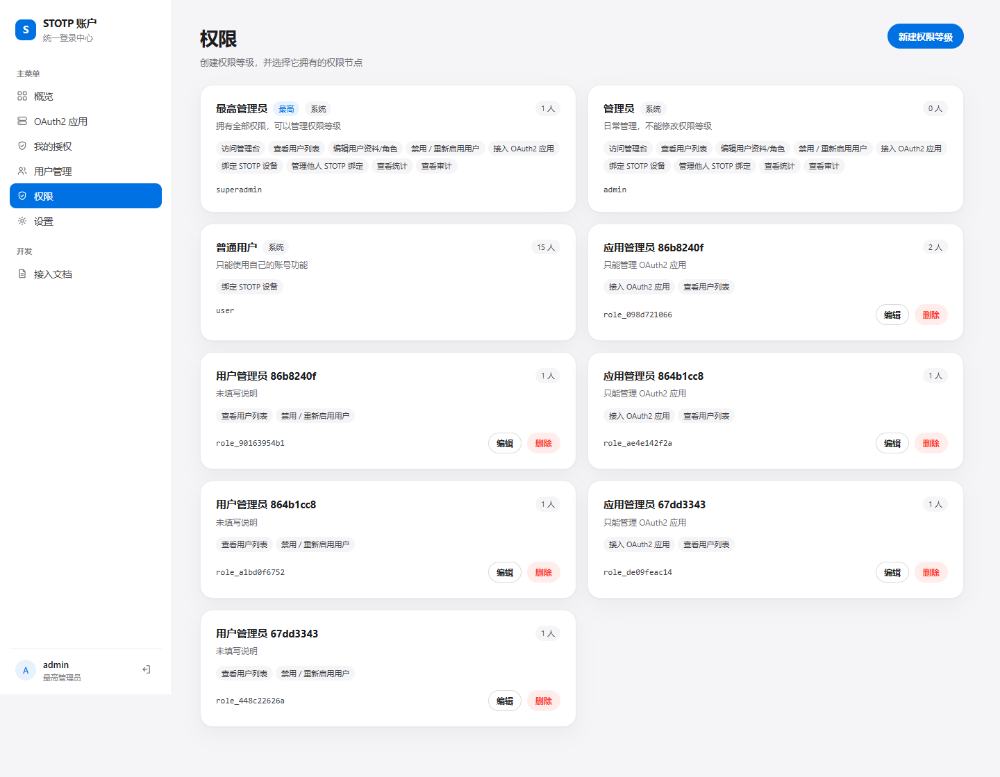
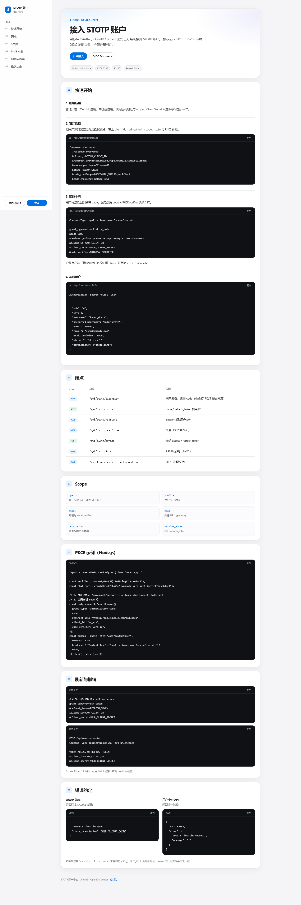
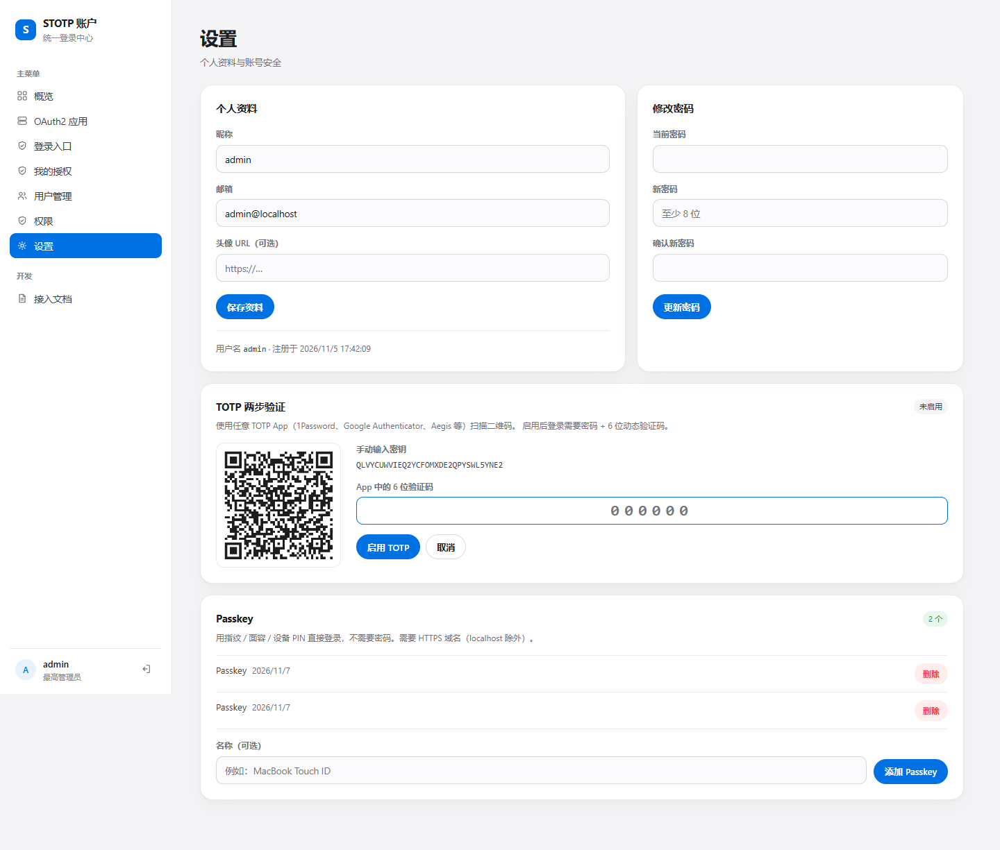
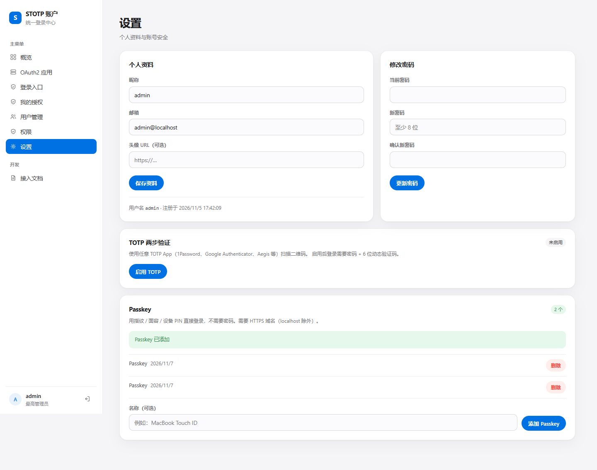
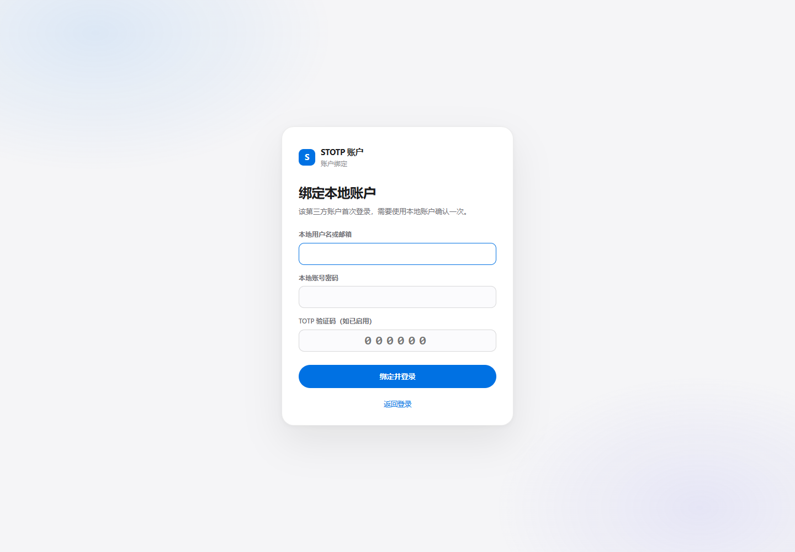
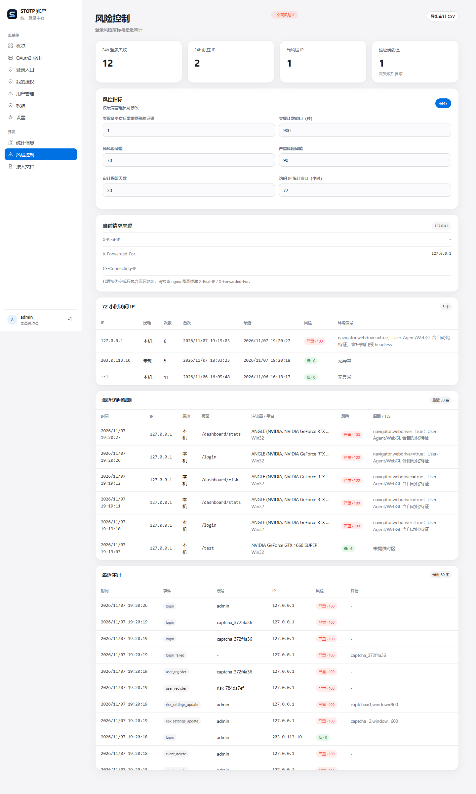
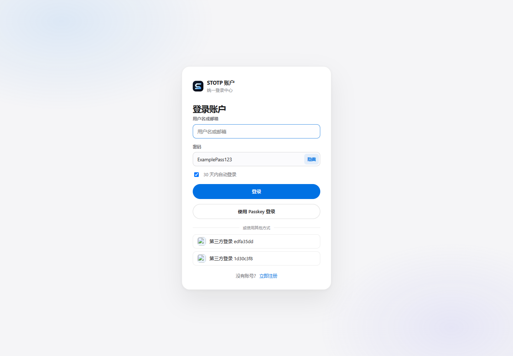

# STOTP Auth Center

一个可被第三方接入的 **OIDC / OAuth2 统一登录站 + 核心 SSO 管理台**。

- 标准 OIDC：授权码 + PKCE(S256)、RS256 id_token/access_token、refresh_token、JWKS、发现文档。
- Scope：`openid`、`profile`、`email`、`head`（头像）、`permission`（权限节点）、`offline_access`。
- 管理台：概览、OAuth2 应用（创建/编辑/密钥轮换/启停/删除）、我的授权（撤销）、用户管理（权限等级/状态）、**权限等级（RBAC）**、个人设置。
- 登录站：登录、注册、授权同意页、退出；密码使用 scrypt 哈希，会话保存在服务端。
- 登录方式：密码、Passkey（无密码）、TOTP 两步验证、外部 OAuth2 登录服务（管理员配置图标/回调）。

技术栈：Next.js 16（App Router）+ React 19 + Node 内置 `node:sqlite`，无外部数据库依赖。

> **Node 版本**：必须 **>= 22.13**，推荐 **Node 24 LTS**。`node:sqlite` 是 Node 22.5 才引入的
> 内置模块，旧版本会在 Next.js 显示 Ready 后、请求页面时报
> `ERR_UNKNOWN_BUILTIN_MODULE: No such built-in module: node:sqlite`。

## 快速开始

```powershell
npm install
$env:AUTH_ADMIN_PASSWORD = "change-me-please"
$env:AUTH_PUBLIC_URL = "http://127.0.0.1:3100"
npm run dev          # http://127.0.0.1:3100
```

首次启动会自动建库并创建管理员（默认 `admin`；密码取 `AUTH_ADMIN_PASSWORD`，未设置时开发环境为
`admin1234`，生产环境随机生成并打印一次）。**上线前务必修改密码。**

> 自动创建只在**用户表为空**时执行。如果库里已经有用户（例如注册过普通账号），改
> `AUTH_ADMIN_PASSWORD` 不会新增管理员；用下面的 seed 命令创建或重置。

### 创建 / 重置管理员

```bash
# 创建或重置 admin，密码用环境变量传入（推荐，避免留在 shell history）
AUTH_ADMIN_PASSWORD='换成强密码' npm run seed

# 或显式指定用户名/密码/邮箱
npm run seed -- admin '换成强密码' admin@example.com
```

脚本会写入 `role=admin`、`status=active`、`permissions=["admin","user"]`；已存在的用户会被更新密码并提升为管理员。
数据库位置按 `AUTH_DB_PATH` > `AUTH_DATA_DIR/auth.db` > `./data/auth.db` 的顺序解析。

生产构建：

```powershell
npm run build
$env:NODE_ENV = "production"
npm run start
```

`npm run start` 只监听 `127.0.0.1:3100`，供同机 nginx 反代；需要局域网直连时用 `npm run start:lan`。
`build` 和 `start` 前都会执行 Node 版本检查，版本不够会直接报错退出，而不是先显示 Ready 再崩。

需要自包含的部署包时，用 `AUTH_STANDALONE=1 npm run build` 生成 `.next/standalone`（可执行 `node server.js`，
需把 `.next/static` 复制到 `.next/standalone/.next/static`）。普通 `npm run build` 行为不变。

反向代理必须保留 Host，否则同源校验会报 `bad_origin`：

```nginx
location / {
    proxy_pass http://127.0.0.1:3100;
    proxy_http_version 1.1;
    proxy_set_header Host              $host;
    proxy_set_header X-Real-IP         $remote_addr;
    proxy_set_header X-Forwarded-For   $remote_addr;
    proxy_set_header X-Forwarded-Proto $scheme;
    proxy_set_header X-Forwarded-Host  $host;
}
```

如果前面是 FRP/CDN 且 nginx 使用 `listen 443 ssl proxy_protocol`，还需要：

```nginx
set_real_ip_from 127.0.0.1;
set_real_ip_from ::1;
real_ip_header proxy_protocol;
real_ip_recursive on;
```

否则 `$remote_addr` 仍然是代理地址，审计会记录成 `127.0.0.1`。

## 配置

| 环境变量 | 默认值 | 说明 |
| --- | --- | --- |
| `AUTH_PUBLIC_URL` | `http://localhost:3100` | 对外基础地址；issuer、发现文档、登录跳转都基于它，必须与浏览器地址一致 |
| `AUTH_DATA_DIR` | `./data` | SQLite、RSA 密钥目录 |
| `AUTH_DB_PATH` | `./data/auth.db` | 覆盖数据库路径 |
| `AUTH_ADMIN_USERNAME` | `admin` | 首次启动创建的管理员用户名 |
| `AUTH_ADMIN_EMAIL` | `admin@localhost` | 管理员邮箱 |
| `AUTH_ADMIN_PASSWORD` | 见上 | 管理员初始密码 |
| `AUTH_TRUST_PROXY` | `1` | 只信任反向代理覆盖后的 `X-Real-IP`；应用直接暴露公网时设为 `0` |
| `AUTH_REQUIRE_ENCRYPTED_PASSWORD` | 生产 HTTPS 默认 `1` | 设为 `0` 可显式允许明文密码 API；浏览器始终使用 RSA 信封加密 |
| `AUTH_REQUIRE_EMAIL_VERIFICATION` | `1` | 注册后必须验证邮箱；`0` 仅用于本地/受控环境 |
| `AUTH_SMTP_HOST` | `smtp.qiye.aliyun.com` | SMTP 主机（后台配置优先） |
| `AUTH_SMTP_PORT` | `465` | SMTP 端口 |
| `AUTH_SMTP_SECURE` | `1` | SSL/TLS |
| `AUTH_SMTP_USER` | `noreply@yxzhou.com` | SMTP 用户名 |
| `AUTH_SMTP_PASS` | 空 | SMTP 密码；推荐在后台「邮件服务」配置，不要写进仓库 |
| `AUTH_MAIL_FROM` | `STOTP <noreply@yxzhou.com>` | 发件人 |
| `AUTH_CONFIG_SECRET` | 自动生成 | 后台敏感配置加密密钥；多实例必须共享 |
| `AUTH_ALLOW_NO_ORIGIN` | `0` | 仅机器对机器脚本需要时设为 `1`；浏览器写请求必须有 Origin |
| `AUTH_ALLOWED_ORIGINS` | 空 | 逗号分隔的完整 Origin，例如 `https://auth.example.com`；用于反代别名，不能靠伪造 Host 通过同源校验 |
| `AUTH_E2E` | `0` | 仅本地 e2e；生产 HTTPS 下设置会拒绝启动 |
| `AUTH_DISPLAY_TZ` | `Asia/Hong_Kong` | 服务端页面显示时间使用的 IANA 时区；数据库仍保存 UTC |
| `PORT` | `3100` | `npm run dev/start` 已固定 3100，可自行改脚本 |

数据目录包含：

- `data/auth.db`：用户、OAuth 应用、授权码、令牌、会话、授权记录、审计。
- `data/oidc-keys.json`：RSA 私钥（0600），用于 RS256 签名；**不要提交或泄露**。
- `data/password-key.json`：RSA 密码信封私钥（0600）。
- `data/avatar-secret`：头像签名密钥（0600）。
- `data/config-secret`：SMTP 等后台敏感配置的加密密钥（0600）。
- `data/auth.db` 的 `app_settings` 保存后台 SMTP 配置；密码使用 AES-256-GCM 加密。

### 反向代理真实 IP

`AUTH_TRUST_PROXY=0` 时应用只信任直连地址，`clientIp()` 会一直返回 `127.0.0.1`；
这会导致所有 IP 维度限速、验证码和风险统计挤进同一个桶。**直连部署没有可用的 IP 维度限速**，
生产环境必须放在会覆盖 `X-Real-IP` 的反向代理后，并保持 `AUTH_TRUST_PROXY=1`（默认）。

如果审计里全是 `127.0.0.1`，说明 nginx 没有把客户端 IP 传给 auth-center。nginx 至少需要：

```nginx
location / {
    proxy_pass http://127.0.0.1:3100;
    proxy_http_version 1.1;

    proxy_set_header Host $host;
    proxy_set_header X-Real-IP $remote_addr;
    proxy_set_header X-Forwarded-For $remote_addr;   # 覆盖，不要追加不可信 XFF
    proxy_set_header CF-Connecting-IP $remote_addr;  # 覆盖，避免上游误信
    proxy_set_header Forwarded "";
    proxy_set_header X-Forwarded-Proto $scheme;
    proxy_set_header X-Forwarded-Host $host;
}
```

完整示例见 [`docs/nginx-auth-center.conf`](docs/nginx-auth-center.conf)。

应用只读取 nginx 覆盖后的 `X-Real-IP`；`CF-Connecting-IP`、`X-Forwarded-For`、`Forwarded` 都不参与身份判断。
`X-Real-IP` 如果被多层代理追加成 `1.2.3.4, 1.2.3.4`，会取第一个合法 IP；nginx 仍应尽量覆盖成单个地址。
修改 nginx 后执行 `nginx -t && systemctl reload nginx`；历史审计里的 `127.0.0.1` 不会自动回填，新登录开始记录真实 IP。

CSP 使用每个请求独立 nonce；`X-Frame-Options`、`nosniff`、`Referrer-Policy`、`Permissions-Policy`
由 Next 下发。nginx 不要再重复添加这些同名头，否则浏览器会收到重复/冲突值；nginx 只保留
`Strict-Transport-Security: max-age=31536000; includeSubDomains` 兜底。

### 后台 CSP 策略

「开发 → CSP 策略」(`/dashboard/developer/csp`) 只有最高管理员可见：

- 可增删任意 CSP 指令和来源；
- 必须先绑定 TOTP，保存/恢复默认需要当前 TOTP 动态码；
- 配置保存在 `app_settings`，由 Node proxy 按请求生成 nonce CSP；
- `script-src` 的 `{{nonce}}` 会替换为当前请求 nonce，保存时会自动补回；
- 错误配置可能导致页面资源无法加载，保存前有二次确认。

如果通过多个域名访问（反代别名），把完整 Origin 写进 `AUTH_ALLOWED_ORIGINS`；
同源校验不再信任请求的 `Host` 头。

## 登录方式

### 注册与邮箱验证

1. 注册页必须填写图形验证码；
2. 账号创建为 `pending`，不签发会话；
3. 服务端发送验证链接（24 小时、一次性）；
4. 打开链接后 `status=active`、`email_verified=1`，才能登录；
5. 未收到可在注册等待页重发。

SMTP 可在后台「邮件服务」配置（仅最高管理员），密码加密存 `app_settings`，不会回显；
也可以通过 `AUTH_SMTP_*` 环境变量作为初始/兜底配置。

`AUTH_REQUIRE_EMAIL_VERIFICATION=0` 可关闭邮箱验证，仅建议本地开发使用。

### 忘记密码

登录页「忘记密码？」→ 输入注册邮箱 + 图形验证码 → 邮件发送 30 分钟一次性重置链接。
不存在的邮箱也返回通用 202，避免账号枚举。

重置时按 IP 风险分、账号角色、邮箱验证状态、TOTP/Passkey 配置计算
`low / medium / high / critical`：

- `low / medium`：邮箱链接即可设置新密码；
- `high / critical`：已启用 TOTP 时要求动态码；未启用 TOTP 时要求二次图形验证码；
- **密码重置本身会作为风险事件**，把账号风险分至少提升到 85（high），之后按天衰减；
  用户管理页显示每个账号的风险等级；
- 重置成功撤销全部会话、令牌、Passkey、第三方绑定。

### 修改邮箱

设置页修改邮箱需要**当前密码**；已启用 TOTP 时还需要动态码。成功后：

- 旧邮箱收到变更通知；
- 新邮箱收到验证邮件；
- 全部会话和令牌撤销，必须重新登录；
- 旧密码重置链接立即作废。

### TOTP 两步验证

设置页「TOTP 两步验证」→ 扫描二维码 → 输入 6 位码启用。启用后登录需要密码 + TOTP 动态码；
关闭时需要当前密码。使用标准 TOTP（SHA1 / 6 位 / 30 秒，允许 ±1 步）。
服务端只保存 AES-256-GCM 加密后的 secret；同一用户同一 timestep 的验证码只能使用一次，防重放。

### Passkey（无密码登录）

设置页「Passkey」添加设备，登录页点「使用 Passkey 登录」即可无密码进入。

- `RP ID` / `Origin` 从 `AUTH_PUBLIC_URL` 自动推导；必须是 **HTTPS 域名**（`localhost` 除外）。
- 换域名会导致已注册 Passkey 失效。
- 添加/删除 Passkey 都在设置页，删除需要已登录会话。

### 外部 OAuth2 登录服务

最高管理员在「登录入口」添加外部 OAuth2 登录服务：

- 名称、图标 URL、Client ID / Secret
- 授权地址、Token 地址、UserInfo 地址、scope
- 统一回调地址：`{AUTH_PUBLIC_URL}/api/oauth/callback`

该服务 UserInfo 必须返回 `sub`（或 `id`）。未绑定的第三方账户首次登录会跳转到本地账户绑定页，
需要使用本地用户名/密码确认一次；绑定页提供「注册本地账户」入口。若该账号启用 TOTP，
密码通过后会进入独立的动态码页面，验证通过才写入绑定并建立会话。
绑定后再次登录直接复用本地账号，不再按邮箱自动创建或接管账号。

### GitHub OAuth 配置示例

| 字段 | 值 |
| --- | --- |
| Authorization URL | `https://github.com/login/oauth/authorize` |
| Token URL | `https://github.com/login/oauth/access_token` |
| UserInfo URL | `https://api.github.com/user` |
| Scope | `read:user`（需要邮箱时用 `read:user user:email`） |
| Callback | `https://auth.yxzhou.com/api/oauth/callback` |

GitHub OAuth App 的 Authorization callback URL 必须与上面的 Callback 完全一致。
GitHub Token 端点默认返回 `application/x-www-form-urlencoded`，auth-center 已同时兼容 JSON 与表单响应。

设置页「第三方登录绑定」可查看并解绑已绑定的服务；解绑后该第三方账户需要重新绑定本地账户。

第三方登录命中本地账号后，如果该账号启用了 TOTP，仍必须进入第二步验证，
不会直接建立会话。

> 外部登录的 `client_secret` 保存在 `data/auth.db`，请确保数据库文件权限为 600 并做好备份。

### 登录行为

- 只启用 TOTP：密码 + TOTP。
- 只启用 Passkey：可直接 Passkey 登录；密码仍可用。
- 两者都启用：密码登录走 TOTP，Passkey 登录独立可用。
- 外部登录服务：登录页显示按钮，走 OAuth2 回调；已绑定本地账号时仍按该账号的 TOTP 策略验证。
- 登录、注册、绑定、修改密码输入框均有「显示/隐藏」明文切换。

### 登录失败图形验证码

同一 IP + 账号在计数窗口内密码失败后，下一次登录必须输入图形验证码：

- 验证码由服务端生成 PNG，带随机旋转、干扰线和噪点；
- 5 分钟有效、一次性、绑定 IP；
- 阈值、失败窗口可在「风险控制」中由最高管理员调整；
- 验证成功或密码正确后清除失败计数。

## 统计与风险控制

「开发」分组新增三个页面：

- **统计信息**：CPU、内存、磁盘、网络收发速率、认证 QPS、负载、运行时间、进程内存。
- **风险控制**：24h 登录失败、独立 IP、高风险 IP、验证码阈值、最近审计与 IP 风险估值。
- **CSP 策略**：最高管理员专用，支持增删 CSP 指令/来源，保存需要 TOTP。

风控指标仅最高管理员可修改，包括验证码触发阈值、失败计数窗口、高中风险阈值、审计保留天数、访问 IP 统计窗口。

### 访问观测与 72h IP

每个页面会通过 `RiskObserver` 上报一次脱敏环境信号（不发机械轨迹）：

- WebGL vendor/renderer、平台、语言、时区、屏幕、CPU 并发数、插件数；
- `navigator.webdriver`、Headless/Puppeteer/Playwright/Selenium UA、软件渲染等自动化特征；
- 服务端记录 IP、UA、TLS 指纹头、页面路径和评分/原因。

风险页会显示：

- **72 小时访问 IP**：IP、中文属地、次数、首次/最近、风险分、环境信号；
  点击「详情」查看该 IP 的 TLS/JA3、UA、WebGL、平台、语言/时区、屏幕、CPU/内存、自动化信号与风险原因；
  拥有 `risk.manage` 的管理员可在详情后点「清除风险」，只忽略该 IP 清除前的历史观测，新风险继续计数；
- **最近访问观测**：渲染器/平台、评分、原因、TLS 指纹；
- 中文属地由 `ip2region` 离线库解析，内网/回环单独标记；
- 支持导出审计 CSV。

TLS 指纹无法由浏览器 JS 计算。若前置 WAF/CDN 提供，会读取
`X-TLS-Fingerprint` / `X-JA3-Fingerprint` / `X-JA4-Fingerprint` / `X-JA3-Hash` / `X-SSL-JA3` 头；
没有时显示未提供，不会伪造。

### IP 观察 / 封禁

拥有 `risk.manage` 权限的管理员可以在风险页维护 IP 规则：

- **观察**：只记录，不拦截；默认 **72 小时**后自动取消追踪；
- **封禁**：拦截新的密码登录、OTP、Passkey、第三方登录和注册；默认长期，除非显式设置到期时间；
- 已有会话不会被踢出，需要单独撤销会话；
- 规则按规范化 IP 保存，支持 IPv4/IPv6。

封禁检查覆盖登录、OTP、Passkey、外部 OAuth2、绑定与注册入口。

### 登录设备与会话

设置页「登录设备」会列出当前账号的有效会话：

- 设备类型 / 浏览器、IP、最近活动时间；
- 当前设备标记；
- 撤销单个设备；
- 退出其他设备（保留当前会话）。

会话记录登录时的 IP/UA，并在访问时更新 `last_seen_at`；撤销当前设备会清除 cookie 并回到登录页。

## 权限等级（RBAC）

管理台使用「权限等级 + 权限节点」，而不是固定的 admin/user 两档。

- **最高管理员（superadmin）**：拥有全部权限，且是唯一可以进入「权限」页创建/编辑权限等级的角色。
- **管理员（admin）**：系统内置的日常管理等级，可查看统计/审计，可编辑权限节点。
- **普通用户（user）**：默认无管理权限。
- 最高管理员可以在「权限」页新建自定义等级，勾选该等级拥有的权限节点；自定义等级可以编辑/删除，
  `admin` / `user` 等内置等级也可以编辑权限节点，只有 `superadmin` 本身不可改。
- 用户管理页可以把用户分配到任意权限等级（仅最高管理员可改）；禁用/启用用户需要 `users.disable`。
- **删除用户仅最高管理员可用**，前端二次确认；删除会清理会话、令牌、Passkey、第三方绑定、授权与挑战记录，不能删除自己或最后一个启用的最高管理员。

权限节点：

| 节点 | 含义 |
| --- | --- |
| `admin.access` | 访问管理台 |
| `users.view` | 查看用户列表 |
| `users.manage` | 编辑用户资料/角色 |
| `users.disable` | 禁用 / 重新启用用户 |
| `oauth.apps.manage` | 接入 / 管理 OAuth2 应用 |
| `login.providers.manage` | 管理外部登录服务 |
| `stats.view` | 查看统计 |
| `audit.view` | 查看审计 |
| `risk.manage` | 管理 IP 观察 / 封禁规则 |

从旧版本升级时，已有的 `admin` 账号会自动迁移为 `superadmin`，其它账号迁移为 `user`；
自定义权限等级保存在 `roles` 表，用户通过 `role_id` 关联。

## 第三方接入

1. 管理员在「OAuth2 应用」创建应用，填写回调地址与 scope；保存时得到的 **Client Secret 只显示一次**。
2. 应用把用户重定向到：

```
GET {AUTH_PUBLIC_URL}/api/oauth/authorize
  ?response_type=code
  &client_id=YOUR_CLIENT_ID
  &redirect_uri=YOUR_CALLBACK
  &scope=openid+profile+email
  &state=STATE
  &code_challenge=PKCE_S256_CHALLENGE
  &code_challenge_method=S256
```

3. 回调拿到 `code` 后，服务端调用 `POST /api/oauth/token` 换取令牌（公共客户端省略 secret，仍必须带 PKCE）。
4. 用 `Authorization: Bearer <access_token>` 调 `GET /api/oauth/userinfo`。

完整字段、refresh/revoke 与错误约定见运行中的 `/docs` 页面。

### 端点

| 方法 | 路径 |
| --- | --- |
| GET | `/api/oauth/authorize` |
| POST | `/api/oauth/token` |
| GET | `/api/oauth/userinfo` |
| GET | `/api/oauth/head?uid=` |
| POST | `/api/oauth/revoke` |
| GET | `/api/oauth/jwks` |
| GET | `/.well-known/openid-configuration` |

## 安全

- 授权码一次性、10 分钟过期，绑定 client / redirect_uri / PKCE。
- Access Token 15 分钟（RS256 JWT），Refresh Token 30 天且每次刷新轮换。
- Client Secret 只存 SHA-256；用户密码 scrypt + 随机盐。
- 注册/改邮箱不会自动验证邮箱，OIDC `email_verified` 只在邮箱验证通过后为 `true`；
  下游应用不要仅凭邮箱自动关联账号。
- 浏览器提交密码前使用服务端 RSA-OAEP 公钥做信封加密；服务端私钥
  `data/password-key.json`（0600）解密后校验 scrypt。覆盖登录、注册、绑定、改密、关闭 TOTP。
- RSA 信封加密是 HTTPS 之外的额外一层，不替代 TLS；生产 HTTPS 默认拒绝明文密码 API，
  可用 `AUTH_REQUIRE_ENCRYPTED_PASSWORD=0` 显式放行（不推荐）。
- TOTP secret 与外部登录的 client_secret 存在 `data/auth.db`，请把数据库权限设为 600 并做好备份；
  外部登录只保存 Passkey 公钥，不保存私钥。
- 登录/注册按 IP 限速；管理 API 校验同源 Origin；Cookie `HttpOnly` + `SameSite=Lax`，HTTPS 部署自动加 `Secure`。
- TOTP：使用 RFC 6238，6 位 / 30 秒 / ±1 步；
  登录 challenge 5 分钟一次性、最多 5 次尝试，绑定设备全局唯一。
- 禁用用户会删除其会话并撤销令牌；修改密码会撤销全部会话、令牌、Passkey 与第三方绑定，并要求重新登录。
- 生产部署请放在 TLS 反向代理后，并把 `AUTH_PUBLIC_URL` 设为 `https://...`。

## 自检

```powershell
# 中英文词条覆盖（CI 会跑）
npm run check:i18n

# 终端 1
$env:AUTH_ADMIN_PASSWORD="admin1234"
$env:AUTH_PUBLIC_URL="http://127.0.0.1:3100"
npm run start

# 终端 2
$env:AUTH_ADMIN_PASSWORD="admin1234"
npm run e2e
```

`check:i18n` 会扫描页面、组件、API 错误文案和动态拼接规则，发现英文模式下没有译文的词条时直接失败。

`e2e` 覆盖：注册、管理员登录、创建应用、授权同意、code 换 token、id_token、userinfo、
refresh 轮换、revoke、公共客户端 PKCE、JWKS、删除应用。

TOTP / Passkey / 外部登录 / 图形验证码 / 风险控制：

```bash
npm run e2e:totp
npm run e2e:provider
npm run e2e:captcha
npm run e2e:encrypted
npm run e2e:risk
npm run e2e:sessions
npm run e2e:password-reset
```

覆盖：TOTP 启用/登录/重放/关闭；外部 OAuth2 授权码回调、本地绑定、TOTP 二阶段绑定、已绑定复用、解绑；
图形验证码触发/错误/正确/计数清除；统计与风险页面、最高管理员修改风控指标、普通用户拒绝修改；
环境观测、72h IP 中文属地、TLS 指纹头、审计 CSV 导出；IP 观察/封禁规则与登录拦截。
`e2e:captcha` 需要以 `AUTH_E2E=1` 启动 auth-center 才会返回测试用验证码文本；生产环境不要设置。
Passkey 使用 Chromium virtual authenticator 做过注册 + 无密码登录实测（需要 HTTPS 域名或 localhost）。

权限等级：

```bash
npm run e2e:rbac
```

覆盖：自定义权限等级、节点校验、superadmin 不可修改、角色分配、页面/API 权限、禁用/启用、非最高管理员限制。

## 截图

| 概览 | OAuth2 应用 |
| --- | --- |
|  |  |

| 登录 | 授权同意 |
| --- | --- |
|  |  |

| 权限等级 | 接入文档 |
| --- | --- |
|  |  |

| 登录方式 | TOTP 设置 |
| --- | --- |
|  |  |

| 外部登录服务 | Passkey |
| --- | --- |
|  |  |

| 第三方账户绑定 | 接入文档 |
| --- | --- |
|  |  |

| 统计信息 | 风险控制 |
| --- | --- |
|  |  |

| 风险观测 / 72h IP | 密码明文切换 |
| --- | --- |
|  |  |

| 图形验证码 | 移动端 |
| --- | --- |
|  |  |

## 集成

- **Z-BlogPHP OAuth2 登录插件**：[`integrations/zblog-oauth2`](integrations/zblog-oauth2/README.md)，支持多个任意 OAuth2/OIDC Provider、授权码 + PKCE、字段映射、自动注册、已验证邮箱绑定。

## 已知限制

- 统计页的 QPS 是认证事件速率，不是全站 HTTP 请求计数；网络指标依赖 Linux `/proc/net/dev`。
- 图形验证码为服务端 PNG，仍属于传统图形验证码，不是无感风控。
- 单节点 SQLite；多实例需替换 `lib/db.ts` 为共享数据库。
- Passkey 需要 HTTPS 域名或 localhost；`AUTH_PUBLIC_URL` 变更会使已注册 Passkey 失效。
- 外部登录 `client_secret` 存在 `data/auth.db`，请限制数据库文件权限。
