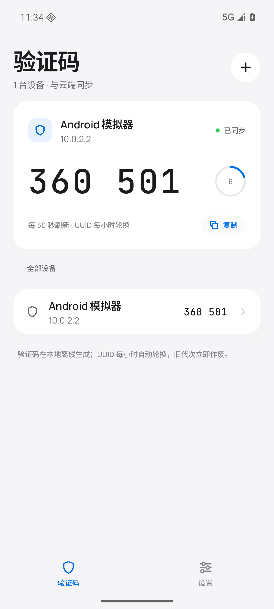
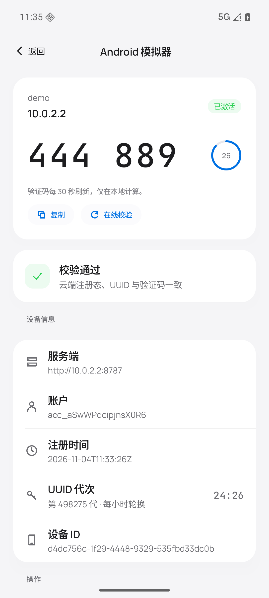
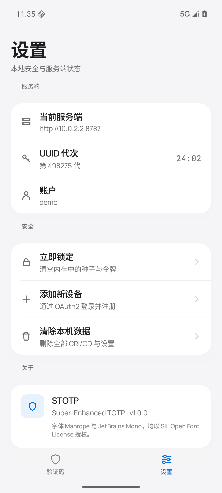
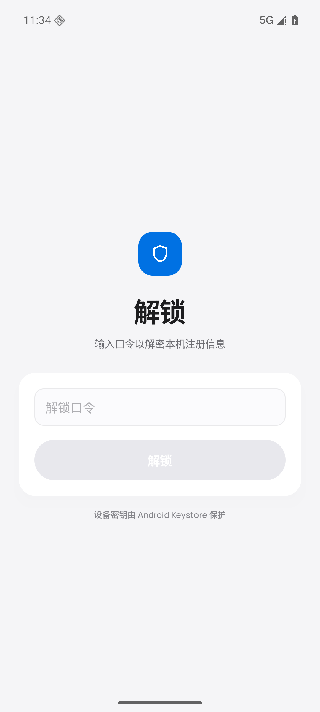

# STOTP Android 客户端

Kotlin + Jetpack Compose 实现。视觉遵循 **Apple Liquid Glass**（冷灰底、统一白色面板 + 发丝线、
玻璃只用于导航/浮层、单一强调蓝），并结合 UI/UX Pro Max 的 Compose 准则（触控目标 ≥ 44dp、
`tabular-nums`、reduced-motion 友好、单源状态）。

## 构建

```powershell
cd android
.\gradlew.bat :app:assembleDebug
# APK: app\build\outputs\apk\debug\app-debug.apk
```

环境：JDK 17+、Android SDK compileSdk 37、AGP 9.5（内建 Kotlin）、Gradle 9.7.1。
首次构建会下载依赖；本机若已有 Gradle 9.7.1 也可直接 `gradle :app:assembleDebug`。

## 运行

```powershell
adb install -r app\build\outputs\apk\debug\app-debug.apk
```

- 模拟器默认连接 `http://10.0.2.2:8787`（宿主机回环）。
- 真机：在「连接服务器」页把地址改为 `http://<电脑局域网 IP>:8787`，并让服务端监听 `0.0.0.0`。
- Debug 构建允许明文 HTTP；Release 构建强制 HTTPS。

## 首次使用

1. 设置解锁口令（≥ 6 位），本地保险库建立（PBKDF2 + Android Keystore）。
2. 输入服务端地址 → 「登录并注册」→ 内置 WebView 完成 OAuth2（PKCE）登录。
3. 客户端自动生成 32B 种子与 UUIDv4 `client_id`，注册设备并同步 `epoch`。
4. 首页显示 6 位验证码与 30 秒倒计时；点击卡片进入设备详情，可在线校验 / 强制轮换 / 吊销。

## 目录

```
android/app/src/main/java/com/endercraft/stotp/
├── MainActivity.kt            # 入口、OAuth 回调、后台 60s 自动锁定
├── core/
│   ├── Crypto.kt              # HKDF / AES-GCM / TOTP / UUIDv8 / PBKDF2
│   ├── Vault.kt               # CRI/CD 二进制格式、令牌封装、Keystore
│   ├── Net.kt                 # HttpURLConnection + OAuth2 + /v1 API
│   ├── Models.kt              # Profile / Tokens / VerifyOutcome
│   └── Bytes.kt               # hex 工具
└── ui/
    ├── StotpApp.kt            # 根导航 + 全局提示
    ├── StotpViewModel.kt      # 单源状态与业务编排
    ├── theme/                 # 颜色、排版（Manrope + JetBrains Mono）、圆角
    ├── components/            # 面板、行、按钮、倒计时环、线性图标、标签栏
    └── screens/               # 解锁 / 连接 / 首页 / 详情 / 设置 / OAuth
```

## 设计令牌

| 角色 | 值 |
| --- | --- |
| Ground | `#F5F5F7` |
| Surface | `#FFFFFF` |
| Text | `#1D1D1F` / `#424245` / `#6E6E73` / `#86868B` |
| Accent | `#0071E3`（唯一强调色） |
| Live | `#30D158`（同步状态点） |
| Hairline | `rgba(0,0,0,0.07)` |
| 圆角 | chip 6 · thumb 12 · sheet 16 · card 18 · panel 22 · hero 26 |
| 字体 | Manrope（UI）/ JetBrains Mono（验证码），SIL OFL |

## 安全

- CRI/CD 落盘加密；种子只在解锁后驻留内存，锁定即清零。
- 令牌按客户端单独以 KEK 封装，不写明文 SharedPreferences。
- `allowBackup=false`；Debug 才允许明文 HTTP。
- 在线校验使用 sealed 响应，App 用种子派生密钥解密，结果不经过明文状态码。

## 截图

| 验证码 | 设备详情 |
| --- | --- |
|  |  |

| 设置 | 解锁 |
| --- | --- |
|  |  |

## 已知限制

- 目前仅浅色主题（深色待后续 issue）。
- 未接入生物识别解锁；依赖口令 + Keystore。
- WebView 登录仅用于联调；生产建议切到 Custom Tabs + 外部登录站。
