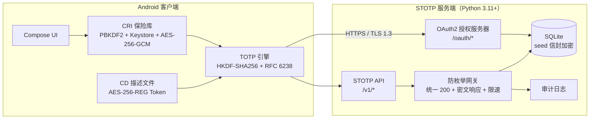
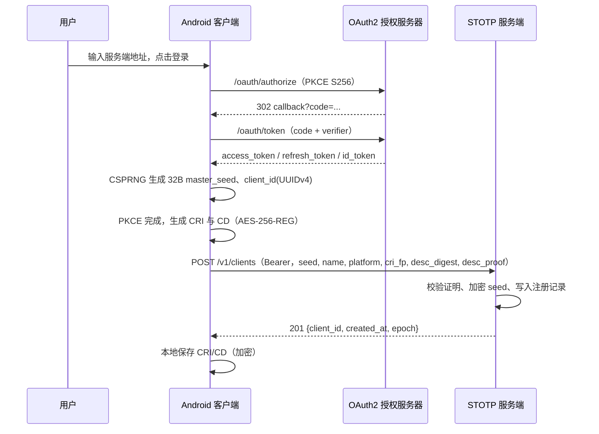
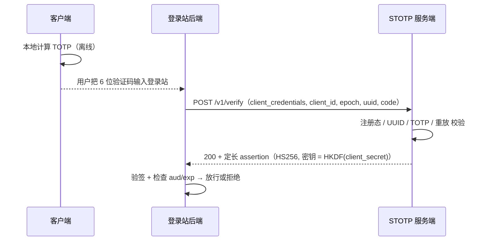
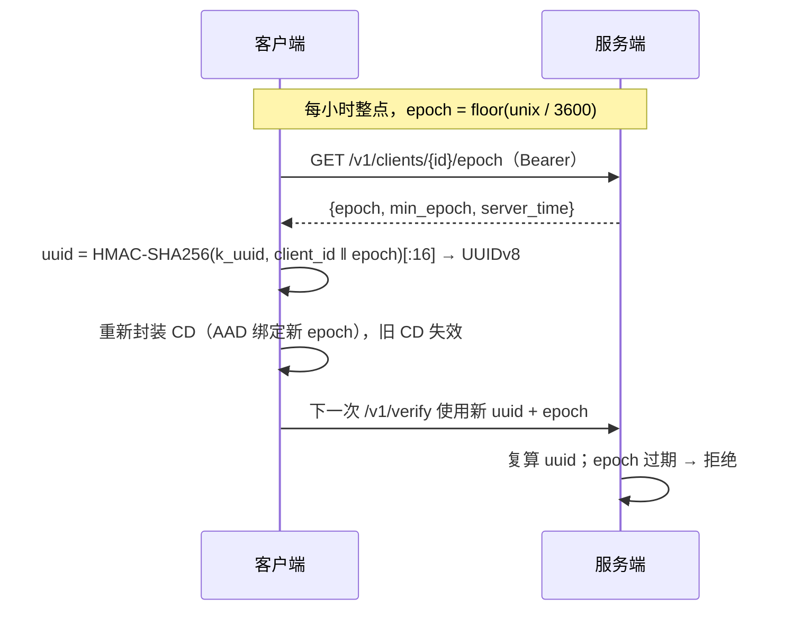

# STOTP 系统架构

> Super-Enhanced TOTP（STOTP）是「TOTP + 在线注册态校验 + 小时级 UUID 轮换」的二次验证方案。
> 本文描述系统边界、组件职责、关键流程与数据模型；密码学细节见 [`crypto-protocol.md`](crypto-protocol.md)，
> 接口定义见 [`api.md`](api.md)，威胁模型与抗枚举设计见 [`security.md`](security.md)。

## 1. 目标与范围

| 目标 | 说明 |
| --- | --- |
| 标准 TOTP 验证 | RFC 6238，HMAC-SHA1，6 位，30 秒步长，允许 ±1 步时钟漂移 |
| 在线注册态校验 | 每次验证都核对「客户端注册信息（CRI）」与云端记录是否一致 |
| 不一致即作废 | CRI 与云端不符、或 CRI 与种子对应关系不符时，该客户端的描述文件立即失效 |
| UUID 小时轮换 | 客户端 UUID 每小时自动更换，上一小时的 UUID 立即作废并释放 |
| 服务端推送轮换 | 服务端可发布 `min_epoch` 公告，已信任客户端在下次同步时跳到新 UUID |
| 抗基础工具枚举 | 验证接口不通过 HTTP 状态码、响应体或耗时泄露任何验证结果 |
| OAuth2 用户中心 | 内置授权服务器；外部登录站可注册自己的回调地址，复用中心服务器 |

**非目标（不在本仓库）**：登录站页面本身。登录站部署在运营方本地，通过 OAuth2 回调接入本服务端。

## 2. 术语

| 术语 | 含义 |
| --- | --- |
| **Master Seed** | 客户端生成的 32 字节根种子，只存在于客户端与「服务端加密库」中 |
| **CRI（客户端注册信息）** | 加密数据文件，保存 master seed、`client_id`、`uuid_epoch`、账户绑定等 |
| **CD（客户端描述文件）** | 由 CRI 种子派生、经 **AES-256-REG** 封装的 TOTP 生成 Token |
| **client_id** | 每个注册客户端唯一的 UUIDv4 |
| **uuid_epoch** | UUID 轮换代次，从 Unix 小时数派生，逐小时递增 |
| **min_epoch** | 服务端公告的最小可用代次；客户端同步后强制跳到该代次 |
| **AES-256-REG** | 本项目定义的「注册绑定 AEAD 档案」：AES-256-GCM + 注册上下文 AAD（见密码学文档） |

## 3. 总体架构



服务端只信任三件东西：

1. **OAuth2 Bearer Token**（用户或服务身份）；
2. **客户端注册记录**（`client_id` → 加密 seed、CRI 指纹、CD 摘要、轮换代次）；
3. **TOTP 计算结果**（服务端用同一 seed 复算，客户端无法伪造）。

> 安全要点：服务端必须能复算 TOTP 与 UUID，因此 seed 会以 AES-256-GCM 信封加密后落库，
> 主密钥不落盘（环境变量 / 密钥文件 / KMS）。这是 OTP 服务端的固有约束，威胁分析见 `security.md`。

## 4. 组件职责

### 4.1 Android 客户端

| 模块 | 职责 |
| --- | --- |
| UI（Jetpack Compose） | 验证码列表与详情、设备注册、同步状态、设置；视觉遵循液态玻璃规范 |
| CRI 保险库 | 用「用户口令 PBKDF2 + Android Keystore 设备密钥」双重派生密钥，AES-256-GCM 加密落盘 |
| CD 描述文件 | 保存 AES-256-REG 封装的 TOTP Token；旧代次描述文件在轮换后失效 |
| TOTP 引擎 | HKDF 派生 → RFC 6238 计算；离线可用，界面仅显示 30 秒倒计时 |
| 同步器 | 启动 / 前台恢复 / 手动刷新时拉取服务端 `min_epoch`，随即重新派生 UUID 与 CD |

### 4.2 服务端

| 模块 | 职责 |
| --- | --- |
| OAuth2 授权服务器 | 动态客户端注册、授权码 + PKCE、刷新令牌、`userinfo`、OIDC 发现文档 |
| 注册 API | 接收 seed 与元数据，计算 CRI 指纹与 CD 摘要，建立注册记录 |
| 轮换 API | 计算当前代次 UUID、发布 `min_epoch`、支持强制轮换 |
| 验证 API | 校验注册态 + UUID + TOTP + 重放，返回固定长度密文结果 |
| 防枚举网关 | 统一 HTTP 200、固定耗时预算、令牌桶限速、失败锁定、审计 |
| 存储层 | SQLite（WAL）；seed 信封加密；令牌/授权码只存哈希 |

## 5. 关键流程

### 5.1 注册（一次性）



### 5.2 验证（每次登录）



客户端自身也可以用用户 Bearer 调用 `/v1/verify`，拿到**种子派生的密文结果**用于本地状态展示。
两种模式的响应都恒为 200、定长、不含明文布尔值：没有 `client_secret` / seed 的一方既解不开，
也无法通过状态码、长度或耗时区分「通过 / 拒绝 / 客户端不存在」。

### 5.3 UUID 小时轮换



- `epoch` 由服务端时钟决定，客户端只做展示与派生，不自行改表。
- `min_epoch` 是服务端公告：运营方可在安全事件后强制所有客户端跳代（`POST /v1/clients/{id}/rotate`）。
- 上一代 UUID 在整点后立即失效，命名空间随之释放（UUID 由 HMAC 确定性派生，不占用全局注册表）。

### 5.4 作废

| 触发 | 服务端动作 | 客户端表现 |
| --- | --- | --- |
| CRI 指纹与云端不符 | `status = revoked`，CD 摘要删除 | 同步失败，提示「注册信息失效，请重新注册」 |
| CD 摘要 / 种子证明不符 | `status = revoked` | 同上 |
| 用户主动吊销 | `status = revoked` | 所有请求 403（OAuth 之后） |
| 管理员强制轮换 | 提升 `min_epoch` | 下次同步自动换 UUID，无需重新注册 |

## 6. 数据模型（SQLite）

| 表 | 关键列 | 说明 |
| --- | --- | --- |
| `accounts` | `id, username, password_hash, created_at` | PBKDF2-HMAC-SHA256，600k 轮 |
| `oauth_clients` | `client_id, secret_hash, name, redirect_uris, created_at` | 动态注册的登录站 |
| `auth_codes` | `code_hash, client_id, account_id, redirect_uri, code_challenge, expires_at` | 10 分钟有效，一次性 |
| `refresh_tokens` | `token_hash, account_id, client_id, scope, expires_at` | 30 天，轮换使用 |
| `stotp_clients` | `id, account_id, name, platform, seed_enc, cri_fp, desc_digest, epoch_override, status` | 每个注册设备一行 |
| `verify_audit` | `ts, client_id, ip_hash, outcome, reason` | 结果仅审计可见，绝不出现在响应中 |

`seed_enc` 为 `AES-256-GCM(master_key, seed)`；`master_key` 来自 `STOTP_MASTER_KEY`（32B base64），
启动时缺失则拒绝启动。

## 7. 目录结构

```
STOTP/
├── README.md
├── docs/
│   ├── architecture.md      # 本文
│   ├── crypto-protocol.md   # 密钥派生、AES-256-REG、UUID 算法
│   ├── api.md               # HTTP API 参考
│   └── security.md          # 威胁模型与抗枚举设计
├── server/
│   ├── stotp/               # 服务端源码（Python 3.11+ / cryptography）
│   ├── tests/               # unittest 自检
│   └── README.md            # 部署与运行
└── android/
    ├── app/                 # Jetpack Compose 客户端
    └── README.md            # 构建与联调
```

## 8. 部署拓扑

```
[Android] ──TLS 1.3──> [反向代理 Caddy/Nginx] ──HTTP/1.1──> [STOTP 服务端 127.0.0.1:8787]
                                                                    │
                                                              [SQLite WAL]
```

- 服务端默认只监听 `127.0.0.1`，TLS 在反向代理终止（证书与 HSTS 由代理负责）。
- 生产环境必须开启 `STOTP_REQUIRE_TLS=1`，拒绝非 HTTPS 的 `X-Forwarded-Proto`。
- 单机 SQLite + WAL 足够支撑中小规模用户中心；水平扩展需将存储替换为 PostgreSQL（接口已隔离在 `store.py`）。

## 9. 版本与兼容

- 协议版本走 URL 前缀（`/v1/`）与 CRI/CD 载荷内的 `v` 字段；破坏性变更升 `v`，不升 URL。
- 客户端与服务端通过 `GET /.well-known/stotp-configuration` 协商 `min_client_version` 与 `algorithms`。
- 服务端保留上一代 `epoch` 解析能力 24 小时，用于客户端升级窗口；超出即拒绝。

## 10. 为什么这样设计

- **TOTP 单独不够**：种子被复制后可无限生成验证码；STOTP 用「在线注册态 + 小时 UUID」把验证码绑到
  「当前设备实例 + 当前小时」，复制出的 CRI 在下一个整点即失效。
- **状态码即预言机**：基础工具最廉价的攻击面。把所有验证结果压进固定长度密文，攻击者拿不到布尔信号。
- **种子必须可被服务端复算**：这是服务端独立验证 OTP 的前提。因此安全边界放在「主密钥 + 落库加密 +
  最小权限 + 审计」，而不是「服务端不存种子」的口号上。
